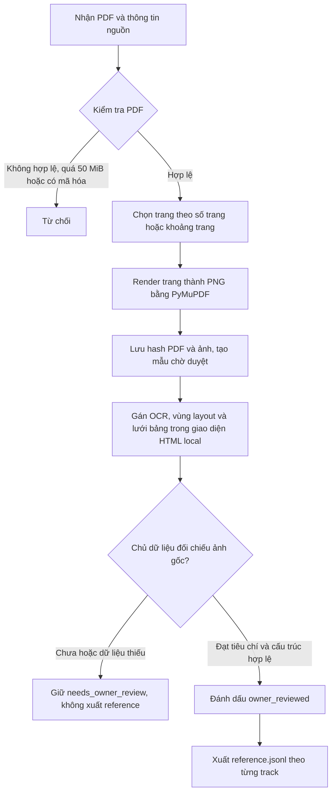

# 1. Dữ liệu và quy trình gán nhãn

## 1.1 Nguồn dữ liệu

Bộ dữ liệu hiện tại được xây dựng từ hai tài liệu PDF tiếng Việt. Tài liệu được lưu cục bộ; với tài liệu Báo Hộ Lao Động, dự án còn lưu URL nguồn công khai. Các trang trong bảng là những trang được đưa vào hàng đánh giá, không phải toàn bộ trang của PDF.

| Nguồn | Trạng thái nguồn | Số mẫu trang | Định dạng và dung lượng | Trường dữ liệu chính |
|---|---|---:|---|---|
| Báo cáo thường niên 2009 của Công ty Cổ phần Bảo hộ Lao động | Online; bản PDF được lưu local. [PDF Vietstock](https://static2.vietstock.vn/data/OTC/2009/BCTN/VN/BaoHoLaoDong_Baocaothuongnien_2009.pdf) | 8 trang chọn từ PDF 27 trang; 4 đã được chủ dữ liệu duyệt, 4 đang chờ duyệt | PDF scan, 11.116.620 byte (10,60 MiB); trang mẫu lưu thành PNG | metadata tài liệu, số trang, ảnh trang, văn bản OCR, vùng bố cục và lưới bảng nếu có |
| Báo cáo tài chính đã kiểm toán năm 2008 của Long Hậu (LHG) | Offline trong kho dữ liệu dự án; trang ghi nhận công bố nêu nguồn ban đầu là HOSE. [Bản ghi tài liệu](https://nmquan.vn/data/ma/LHG/cong-bo/28075241-2-bctc-da-kiem-toan-2008-v) | 8 trang chọn từ PDF 22 trang; cả 8 đã được chủ dữ liệu duyệt | PDF scan, 3.605.643 byte (3,44 MiB); trang mẫu lưu thành PNG | metadata tài liệu, số trang, ảnh trang, văn bản OCR, vùng bố cục và lưới bảng nếu có |

Tổng cộng có **16 mẫu trang** từ hai PDF khác nhau theo nội dung (tổng dung lượng PDF gốc 14.722.263 byte, tương đương 14,04 MiB). Có 12 trang mang trạng thái `owner_reviewed`, 4 trang đang `needs_owner_review`. Ảnh PNG của 16 trang có tổng dung lượng 17.017.954 byte (16,23 MiB). Tính đến 2026-10-21, các file tham chiếu hiện hành có 12 mẫu OCR, 12 mẫu layout, 17 bản ghi bảng và 11 mẫu end-to-end. Số bản ghi bảng lớn hơn số trang vì một trang có thể chứa nhiều bảng; end-to-end hiện không có một trang đã duyệt do trang đó chưa có lưới bảng được duyệt.

Mỗi mẫu giữ thông tin truy nguyên gồm `document_id`, số trang nguồn, đường dẫn và SHA-256 của PDF, đường dẫn và SHA-256 của ảnh trang, trạng thái duyệt và thời điểm duyệt. Mẫu OCR có `ocr_reference_text`. Mẫu layout lưu `regions` với `region_id`, nhãn (`title`, `text`, `table`, `figure`), hộp giới hạn chuẩn hóa `[x1, y1, x2, y2]` trong khoảng 0–1 và `reading_order`. Mẫu bảng lưu `table_region_id`, `table_bbox_norm`, `cell_grid` cùng số hàng và cột.

Các số liệu trên được tính từ trạng thái duyệt local và các file `reference.jsonl` hiện hành. `data/README.md` chưa phản ánh snapshot này và cần được cập nhật trước khi dùng làm nguồn trích số liệu khác.

## 1.2 Làm sạch và gán nhãn

### Luồng xử lý

Khi nạp, hệ thống kiểm tra chữ ký PDF, giới hạn kích thước 50 MiB, từ chối PDF mã hóa, giới hạn tối đa 100 trang được chọn mỗi yêu cầu và giới hạn ảnh render 24 triệu pixel. Trang được render bằng PyMuPDF với hệ số phóng đại tối đa 2; ảnh trang gốc được giữ làm căn cứ gán nhãn. Hệ thống tránh thêm trùng cùng cặp `document_id` và số trang, đồng thời lưu hash để truy nguyên. Tuy nhiên, đây chưa phải khử trùng lặp toàn cục theo nội dung: cùng một PDF Bảo hộ Lao động đã xuất hiện dưới hai ID tài liệu khác nhau dù SHA-256 giống nhau. Vì vậy, trước khi chia tập hoặc tuyên bố độc lập giữa các tập, cần chuẩn hóa tài liệu theo hash PDF.

Không có bước khử nhiễu, deskew, dewarp hay tự điền dữ liệu trong quy trình tạo reference hiện tại. Trang scan được giữ nguyên sau khi render. Trang thiếu hoặc chưa hoàn tất vẫn ở trạng thái chờ duyệt và không được xuất vào reference; không nội suy nhãn còn thiếu.

### Công cụ và tiêu chí gán nhãn

Gán nhãn được thực hiện trong giao diện HTML local `data/review.html`; máy chủ và trạng thái nằm tại `data/review_server.py` và `data/local-review-state.json`. Dữ liệu đã duyệt được xuất theo track tại `data/ocr/reference.jsonl`, `data/layout/reference.jsonl`, `data/table/reference.jsonl` và `data/end-to-end/reference.jsonl`.

Tiêu chí duyệt là đối chiếu trực quan từng nhãn với ảnh trang nguồn. Nội dung OCR phải bám sát chữ nhìn thấy; vùng layout phải có nhãn và hộp tọa độ chuẩn hóa đúng với vùng trên trang, đồng thời thể hiện thứ tự đọc; lưới bảng phải có cấu trúc hàng/cột phù hợp và gắn với một vùng bảng hợp lệ. Các kiểm tra cấu trúc xác nhận ID vùng, tọa độ trong miền chuẩn hóa, lưới chữ nhật và liên kết giữa lưới với vùng bảng. Những kiểm tra này không tự chứng minh nội dung phiên âm chính xác; trạng thái `owner_reviewed` biểu thị chủ dữ liệu đã xem và duyệt mẫu.

Trong 12 trang đã duyệt, 11 bản nháp được tạo bằng phiên âm thủ công; bản nháp trang 26 được tạo bằng Codex CLI vision rồi chủ dữ liệu đối chiếu và duyệt. Có 4 trang vẫn chờ duyệt và không được tính là dữ liệu đã duyệt.

### Độ nhất quán giữa người gán nhãn

Không báo cáo Cohen’s Kappa trong snapshot hiện tại. Dữ liệu không lưu mã người gán nhãn thứ hai hoặc các lượt gán độc lập trùng nhau, nên không đủ cặp nhãn để tính Kappa. Trạng thái và thời điểm `owner_reviewed` chỉ ghi nhận việc chủ dữ liệu duyệt, không phải phép đo đồng thuận liên người.
