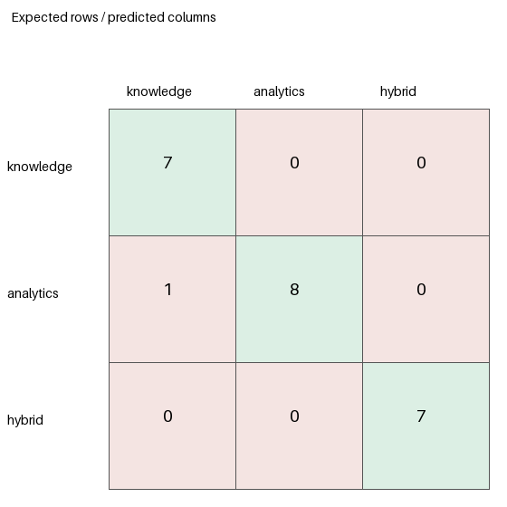

# Agent Router Benchmark ? 25 Questions

**Run:** 2026-10-25 09:17 UTC  
**Branch / commit:** `QuocAn` / `fed98243b2f87e47623d52161b2ade92e70b640f`  
**Model:** `openai/gpt-oss-120b` through Groq Responses API  
**Dataset:** `fa26ai69-router-benchmark-25-v1` (25 manually labeled English cases; 8 knowledge, 10 analytics, 7 hybrid)  
**Dataset SHA-256:** `29911ad6df6981071bff902b76e767d612103267c2e55af7eaad6a5d39290c32`

## Result

The current production classifier/router selected the expected route for **22 of 25 questions (88%)**, below the suggested 90% target (23/25). Its **Macro F1 was 0.921**, above the suggested 0.85 target. It routed all seven hybrid questions correctly. The three errors were a knowledge request sent to `report`, an analytics request sent to `dashboard`, and an analytics request sent to `knowledge`.

This is a router-only benchmark. Stub agents returned immediately after dispatch, so these figures do not measure retrieval, SQL execution, answer quality, or access control.

## Implementation inspected

The benchmark uses the labels and behavior in the current code:

- `Intent` defines `knowledge`, `analytics`, `dashboard`, `hybrid`, and `report`.
- `IntentClassifier` asks the configured Groq provider for JSON containing intent, `needs_knowledge`, `needs_sql`, output mode, and confidence. It validates the response and normalizes it against a deterministic fallback.
- The fallback uses the metric ontology, document-count and product-ID patterns, keyword rules, and year/comparison cues. It returns a fixed confidence of `0.35`.
- The normalizer has explicit document-count, report, analytics, and hybrid handling. A rule result may replace a successfully parsed LLM response; that is tracked separately from provider errors.
- The automatic LangGraph route is `report` when a report agent exists, then `dashboard` for dashboard output, `hybrid` when both `needs_knowledge` and `needs_sql` are set, `analytics` when SQL is needed, and otherwise `knowledge`. The hybrid node runs both agents concurrently. The graph also has an `invalid` destination for the separate agentic selection path.
- Existing `scripts/agents/evaluate_agent_routes.py` measures a different, 12-case dataset. The added harness and dataset are separate and leave production code unchanged.

The raw-LLM baseline maps the parsed intent flags through the same route mapping without classifier normalization. The rule-only baseline invokes the deterministic fallback and makes no model call. Each configuration was run over the same cases. The LLM calls are independent; provider nondeterminism can change their outputs across runs.

## Baseline comparison

| Configuration | Correct | Incorrect | Accuracy | Macro F1 | Weighted F1 |
|---|---:|---:|---:|---:|---:|
| Rule-based only | 18 | 7 | 72% | 0.750 | 0.747 |
| Raw LLM classification | 23 | 2 | 92% | 0.943 | 0.937 |
| Current production classifier + router | 22 | 3 | 88% | 0.921 | 0.916 |

The production result is one correct route below target. On this sample, normalization/fallback reduced accuracy by four percentage points compared with the independent raw LLM run; this is a descriptive comparison, not a causal estimate, because the provider calls were separate.

## Production class metrics

| Route | Precision | Recall | F1 | Support |
|---|---:|---:|---:|---:|
| knowledge | 0.875 | 0.875 | 0.875 | 8 |
| analytics | 1.000 | 0.800 | 0.889 | 10 |
| hybrid | 1.000 | 1.000 | 1.000 | 7 |
| **Macro / weighted** | ? | ? | **0.921 / 0.916** | **25** |

Precision, recall, and F1 use zero-division convention: precision/recall are `null` when their denominator is zero; F1 is 0 when both are defined and sum to zero. Macro F1 averages defined class F1 values; weighted F1 weights each class by its full expected support. Out-of-scope routes are incorrect and are listed separately below. Accuracy always uses all 25 questions.

### Production confusion matrix

Rows are expected routes; columns are predicted routes. The 3?3 matrix contains in-scope predictions; out-of-scope `report` and `dashboard` predictions are listed after it and included as errors in the full-set metrics.

| Expected \ Predicted | knowledge | analytics | hybrid |
|---|---:|---:|---:|
| knowledge | 7 | 0 | 0 |
| analytics | 1 | 8 | 0 |
| hybrid | 0 | 0 | 7 |

Out-of-scope predictions: expected `knowledge` ? `report` (Q006), 1; expected `analytics` ? `dashboard` (Q016), 1. The in-scope confusion was expected `analytics` ? `knowledge` (Q018), 1. No `knowledge`/`hybrid` pair was confused.

## Latency

Monotonic `perf_counter_ns` timing; P95 uses nearest-rank. Production router latency ends at the final LangGraph route with stub dispatch and excludes downstream work.

| Configuration | Mean | P50 | P95 | Min | Max |
|---|---:|---:|---:|---:|---:|
| Rule-based only | 0.85 ms | 0.61 ms | 1.06 ms | 0.46 ms | 6.14 ms |
| Raw LLM | 2,036.71 ms | 1,086.59 ms | 4,822.59 ms | 595.69 ms | 8,432.62 ms |
| Production router-only | 1,669.41 ms | 1,087.86 ms | 3,922.74 ms | 580.57 ms | 7,692.90 ms |

## Fallback, normalization, and confidence

- Production returned a rule-based result for **6/25 (24%)** cases. Those cases were **5/6 correct (83.3%)**; non-fallback cases were **17/19 correct (89.5%)**.
- Provider failures: **0**. All 25 production provider responses were available; the fallback count was not caused by provider failure.
- Rule-result replacement events: **6** (Q006, Q009, Q011?Q014). Q006 changed the intent to `report`; the other five retained `analytics` as the intent label but used the fallback result (including its fallback confidence and rule-derived fields).
- Mean reported confidence: correct production predictions **0.840**; incorrect **0.757**. The six fallback results use fixed confidence **0.35**. These are model-reported values, not calibrated probabilities.

## Performance by difficulty

| Difficulty | Correct | Total | Accuracy |
|---|---:|---:|---:|
| Easy | 7 | 7 | 100% |
| Medium | 11 | 13 | 84.6% |
| Hard | 4 | 5 | 80% |

The errors were concentrated in medium (two) and hard (one) cases; there were no easy-case errors. Hybrid routing was 7/7, while harder analytics cases account for the analytics misses.

## Intent classification, route selection, and execution status

1. **Intent classification:** measured by the raw LLM and rule-only baselines, plus the production classifier output. Results are in the baseline table and per-question JSON.
2. **Agent routing:** measured with the actual `AgentRouter` LangGraph and lightweight stub agents. Production accuracy was 22/25; hybrid destinations were represented by the router?s `hybrid` route and dispatched to both agents.
3. **End-to-end execution with authorized data:** **not run**. The environment has configured provider and database credentials, but this run did not establish document authorization. `KnowledgeAgent.run` calls `RAGService.generate_answer` without passing request identity, company, or roles, although the RAG service and retrieval layer expose role filters. Running real document questions would therefore not let this benchmark verify that returned evidence was authorized. We did not claim answer success, data availability, or evidence authorization. The analytics repository code uses approved query validation and a read-only transaction, but no live SQL execution was part of this benchmark.

## Artifacts and reproduction

- Query-level results (75 records, one per question/configuration), metrics, latencies, confidences, confusion data, model and dataset metadata: [`results.json`](results.json)
- Production visualization: [`confusion-production.png`](confusion-production.png); baseline visualizations: [`confusion-rule_based_only.png`](confusion-rule_based_only.png), [`confusion-raw_llm.png`](confusion-raw_llm.png)
- Dataset: [`router_benchmark_25.json`](../../../data/evaluation/router_benchmark_25.json)
- Harness: [`benchmark_router_25.py`](../../../scripts/agents/benchmark_router_25.py)
- Reproduce from repository root with `.venv/Scripts/python.exe scripts/agents/benchmark_router_25.py`. This calls the configured Groq model 50 times (25 raw baseline + 25 production); the rule-only baseline is local. Results may vary with provider responses and latency.
- Python: 3.11.16; platform: Windows 10. Implementation file hashes are included in `results.json`.

