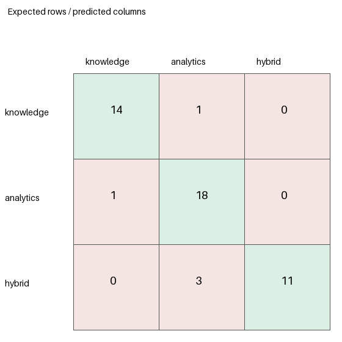

# Agent Router Benchmark - 50 Questions

**Run completed:** 2026-10-25 10:44 UTC
**Branch / commit:** `QuocAn` / `fed98243b2f87e47623d52161b2ade92e70b640f`
**Model:** `openai/gpt-oss-120b` through Groq Responses API
**Dataset:** `fa26ai69-router-benchmark-50-v1` (50 manually labeled English cases: 16 knowledge, 20 analytics, 14 hybrid)
**Dataset SHA-256:** `d2200d9ae1186c154a80b985a666d110fe1f93444ef73270e34f53f73ebe0865`

## Result

The current production classifier/router selected the expected route for **43/50 questions (86%)**, below the suggested 90% target (45/50). Macro F1 was **0.880**, above the suggested 0.85 target. It routed 11/14 hybrid questions correctly.

This was an append-only continuation: the original Q001-Q025 result records were retained unchanged. The harness ran only Q026-Q050 in the added pass, then recomputed the metrics over the combined 50 records per configuration. The run history and `evaluated_case_ids_this_run` in `results.json` identify the two batches.

This is a router-only benchmark. Stub agents returned immediately after dispatch, so the results do not measure retrieval, SQL execution, answer quality, or access control.

## Implementation inspected

The benchmark uses the actual labels and behavior in the current code:

- `Intent` defines `knowledge`, `analytics`, `dashboard`, `hybrid`, and `report`.
- `IntentClassifier` requests JSON from the configured Groq provider with intent, `needs_knowledge`, `needs_sql`, output mode, and confidence. It validates the response and normalizes it against a deterministic fallback.
- The fallback uses the metric ontology, document-count and product-ID patterns, keyword rules, and year/comparison cues. It returns a fixed confidence of `0.35`.
- The normalizer has explicit document-count, report, analytics, and hybrid handling. A rule result can replace a parsed LLM result; that is tracked separately from provider failure.
- In automatic mode, LangGraph routes to `report` when a report agent exists, then `dashboard` for dashboard output, `hybrid` when both knowledge and SQL are needed, `analytics` when SQL is needed, and otherwise `knowledge`. The hybrid node runs both agents concurrently. The graph also has an `invalid` destination for the separate agentic-selection path.
- The checked-in 12-case evaluator uses a different dataset. The 50-case dataset and harness are separate; production router, classifier, prompts, and agents were not changed.

Rule-only classification invokes the deterministic fallback without a model call. Raw LLM classification parses the model response and maps its flags through the router's route mapping without classifier normalization. Production uses the current classifier and LangGraph. LLM calls are independent; provider responses and latency can vary across runs.

## Baseline comparison

| Configuration | Correct | Incorrect | Accuracy | Macro F1 | Weighted F1 |
|---|---:|---:|---:|---:|---:|
| Rule-based only | 34 | 16 | 68% | 0.692 | 0.689 |
| Raw LLM classification | 48 | 2 | 96% | 0.972 | 0.969 |
| Current production classifier + router | 43 | 7 | 86% | 0.880 | 0.878 |

Production is two correct routes short of the target. It is 10 percentage points below the raw LLM baseline in this run. Since the model calls were separate, this comparison is descriptive and does not isolate normalization as a causal factor.

## Production per-class metrics

| Route | Precision | Recall | F1 | Support |
|---|---:|---:|---:|---:|
| knowledge | 0.933 | 0.875 | 0.903 | 16 |
| analytics | 0.818 | 0.900 | 0.857 | 20 |
| hybrid | 1.000 | 0.786 | 0.880 | 14 |
| **Macro / weighted F1** | - | - | **0.880 / 0.878** | **50** |

Precision and recall are `null` when their denominator is zero; F1 is 0 when both are defined and sum to zero. Macro F1 averages defined class F1 values; weighted F1 weights by full expected support. Out-of-scope destinations count as incorrect and are reported separately. Accuracy uses all 50 cases.

### Production confusion matrix

Rows are expected routes; columns are predicted routes. The 3x3 matrix contains in-scope predictions. `report` and `dashboard` destinations are listed separately and included as errors in all full-set metrics.

| Expected \ Predicted | knowledge | analytics | hybrid |
|---|---:|---:|---:|
| knowledge | 14 | 1 | 0 |
| analytics | 1 | 18 | 0 |
| hybrid | 0 | 3 | 11 |

Out-of-scope: expected `knowledge` -> `report` (Q006), one; expected `analytics` -> `dashboard` (Q016), one. In-scope confusions: knowledge -> analytics (Q033), analytics -> knowledge (Q018), and hybrid -> analytics (Q046, Q049, Q050). No other route pairs were confused.

## Latency

Measured with monotonic `perf_counter_ns`; P95 uses nearest-rank. Production router-only latency ends after the final LangGraph route and stub dispatch, excluding downstream work.

| Configuration | Mean | P50 | P95 | Min | Max |
|---|---:|---:|---:|---:|---:|
| Rule-based only | 0.92 ms | 0.68 ms | 1.27 ms | 0.46 ms | 6.14 ms |
| Raw LLM | 1,936.33 ms | 1,090.79 ms | 4,347.82 ms | 514.09 ms | 8,432.62 ms |
| Production router-only | 1,758.58 ms | 1,074.02 ms | 3,819.22 ms | 579.95 ms | 7,692.90 ms |

## Fallback, normalization, and confidence

- Production returned a rule-based result for **16/50 (32%)** cases. Those were **11/16 correct (68.8%)**; non-fallback cases were **32/34 correct (94.1%)**.
- Provider failures: **0**. Fallback results were not caused by provider failures.
- Rule-result replacement events: **16**. The cases and raw/normalized intents are recorded in `results.json`; some retain the same intent label while rule-derived fields and fixed fallback confidence replace the model result.
- Mean reported confidence: correct production predictions **0.824**; incorrect **0.530**. Rule fallback confidence is fixed at **0.35** (16 cases). These values are not calibrated probabilities.

## Performance by difficulty

| Difficulty | Correct | Total | Accuracy |
|---|---:|---:|---:|
| Easy | 11 | 11 | 100% |
| Medium | 22 | 25 | 88% |
| Hard | 10 | 14 | 71.4% |

Errors rise with difficulty. Three of the seven errors are hard hybrid requests routed to analytics, so hybrid and harder cases merit attention in any later follow-up benchmark.

## Three evaluation levels

1. **Intent classification:** measured through the raw LLM baseline, rule-only baseline, and production classifier output. Query-level raw intent, normalized intent, and confidence are recorded.
2. **Agent routing:** measured with the actual `AgentRouter` LangGraph and stub destination agents. Production accuracy is 43/50. The router selected the `hybrid` destination for 11 of 14 expected hybrid requests.
3. **End-to-end execution with authorized data:** not run. The current `KnowledgeAgent` calls `RAGService.generate_answer` without passing request identity, company, or roles, although the retrieval layer exposes role filters. This run therefore cannot establish whether document evidence returned for the benchmark would be authorized. We did not claim answer success or evidence authorization. The analytics repository uses approved-query validation and read-only transactions, but no live SQL execution was part of this benchmark.

## Artifacts and run record

- Combined 150 query/configuration records, full metrics, latency, confidence, confusion data, and batch history: [`results.json`](results.json)
- Production visualization: [`confusion-production.png`](confusion-production.png); baselines: [`confusion-rule_based_only.png`](confusion-rule_based_only.png), [`confusion-raw_llm.png`](confusion-raw_llm.png)
- 50-question dataset: [`router_benchmark_50.json`](../../../data/evaluation/router_benchmark_50.json)
- Original 25-question dataset preserved: [`router_benchmark_25.json`](../../../data/evaluation/router_benchmark_25.json)
- Append-capable harness: [`benchmark_router_25.py`](../../../scripts/agents/benchmark_router_25.py)

The append pass used `.venv/Scripts/python.exe scripts/agents/benchmark_router_25.py --append`. It loaded the saved Q001-Q025 results and selected Q026-Q050 only; the exact appended IDs and run timestamps are in `results.json`. Python 3.11.16; Windows 10. Implementation hashes are included in the results file.
