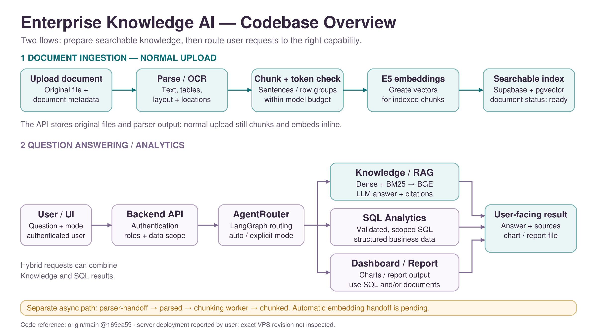
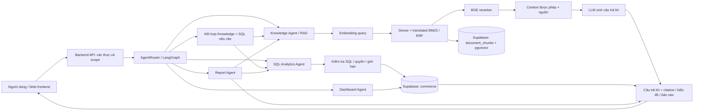
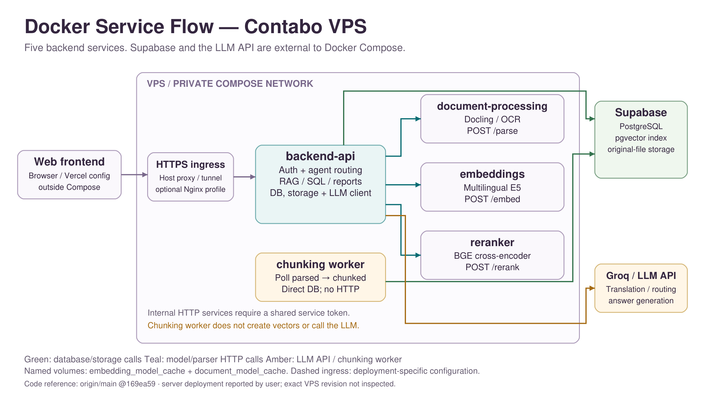
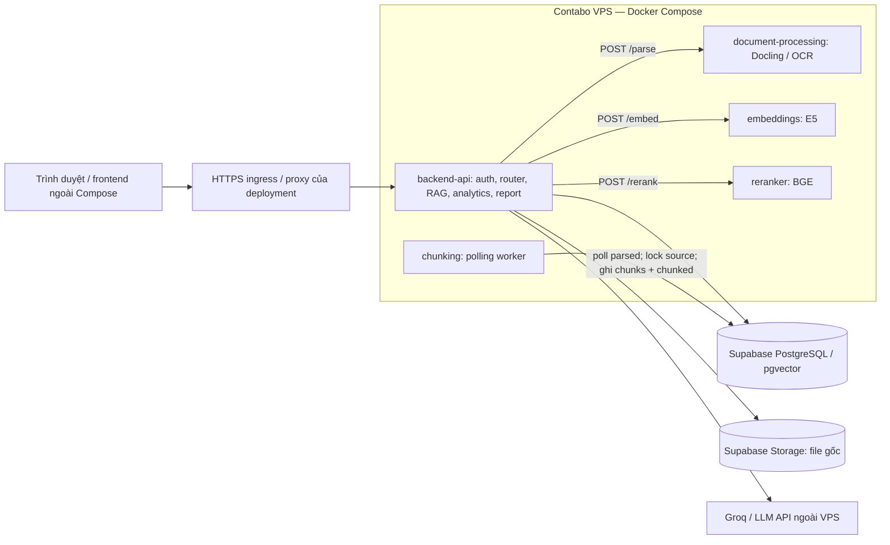
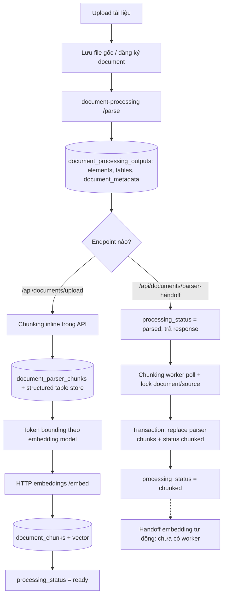

# Luồng tổng quát codebase và Docker — 29/10/2026

Đối chiếu trực tiếp `origin/main` tại **169ea59**. Đọc remote bằng `git show`, không checkout/merge main vào Huy và không sửa code runtime. Người dùng xác nhận VPS đã deploy/host; sơ đồ mô tả code và Compose được đọc, không xác nhận commit, ingress, domain hay từng container thực tế trên VPS vì chưa có phiên kiểm tra server.

## 1. Tổng quan cho slide

Luồng nghiệp vụ có hai nửa:

1. **Chuẩn bị kiến thức:** upload → parse/OCR → chunking và giới hạn token → embedding → lưu index để truy xuất.
2. **Sử dụng kiến thức/dữ liệu:** người dùng → API xác thực/phân quyền → router → Knowledge/SQL/Dashboard/Report → kết quả cho người dùng.

Lưu ý: đây là sơ đồ gọi chức năng, không có nghĩa mỗi Agent là một container. Report có thể dùng documents, analytics hoặc combined theo lựa chọn và quyền; nhánh report có kiểm tra nguồn và đầu ra Markdown/DOCX. Dashboard dùng dữ liệu có cấu trúc. Router hỗ trợ auto, knowledge, sql, dashboard, agentic và report. Hybrid/both có thể chạy Knowledge và SQL rồi kết hợp kết quả.

## 2. Service Docker trên VPS

- **backend-api:** cổng host `127.0.0.1:8000`; điều phối request, quyền, DB/storage và LLM. Retrieval/agent logic là module trong API, không phải container riêng.
- **document-processing:** HTTP nội bộ `/parse`, xử lý parser/OCR; không trực tiếp quản lý giao dịch DB trong runtime này.
- **embeddings:** HTTP nội bộ `/embed`; model cấu hình mặc định multilingual-e5-base, có thể bị env override. API chuẩn bị prefix/normalization theo embedding service.
- **reranker:** HTTP nội bộ `/rerank`, chấm query–chunk bằng BGE.
- **chunking:** không có HTTP; dùng `DATABASE_URL`, đọc tài liệu `parsed`, khóa `FOR UPDATE SKIP LOCKED`, ghi parser chunks và đổi `chunked` nguyên tử. Không gọi embeddings hoặc LLM.
- **proxy:** Nginx trong Compose là profile tùy chọn `proxy`, bind `127.0.0.1:8080`; không tự kết luận VPS đang dùng Nginx profile này. HTTPS/host proxy/tunnel phụ thuộc deployment.
- **Supabase và Groq:** bên ngoài Compose; không vẽ PostgreSQL hoặc LLM local trên VPS.
- Các HTTP service nội bộ không publish host port; dùng `INTERNAL_SERVICE_TOKEN`. Không đưa token, URL bí mật hoặc credential vào slide.
- Hai named volumes: `embedding_model_cache` (API/embeddings/reranker) và `document_model_cache` (parser). Cache không phải kho dữ liệu giao dịch.
- Frontend có cấu hình Vercel; Compose không chạy frontend. Đích HTTPS trong môi trường frontend cần khớp deployment thực tế.

## 3. Ingestion: phân biệt hai đường hiện tại

`retry-embedding` đã có trong API để xử lý lại từ parser chunks trong phạm vi trạng thái/điều kiện mà endpoint hỗ trợ. Không có nghĩa có embedding worker tự nhận mọi tài liệu `chunked`. Không gọi toàn bộ ingestion là async end-to-end. Chưa xác minh đường retry hiện tại có chấp nhận trực tiếp trạng thái chunked mới hay cần điều chỉnh contract.

## 4. Dữ liệu đi đâu?

| Kho/bảng | Vai trò |
|---|---|
| Supabase Storage | File gốc upload |
| `documents` | Danh tính, trạng thái, access roles, khả năng dùng trong knowledge base |
| `document_processing_outputs` | Parser output canonical trước chunking |
| `document_parser_chunks` | Chunk văn bản/bảng trước embedding |
| `extracted_tables`, `extracted_records` | Bảng và hàng có cấu trúc trong đường upload thường |
| `document_chunks` | Nội dung truy xuất, metadata và embedding đang dùng |
| `commerce.*` | Dữ liệu nghiệp vụ phục vụ SQL/analytics/dashboard |
| `agent_run_events` | Telemetry request/agent, không thay hồ sơ giao dịch |

## 5. Cách nói ngắn khi thuyết trình

> Hệ thống có hai luồng chính. Luồng đầu tiếp nhận tài liệu, trích xuất nội dung, chia chunk và tạo vector để tìm kiếm. Luồng thứ hai nhận câu hỏi, xác thực quyền rồi điều phối đến truy xuất tri thức, SQL, dashboard hoặc báo cáo. Backend gọi các service parser, embedding và reranker qua mạng Docker nội bộ; Supabase lưu dữ liệu và file gốc, còn LLM được gọi qua API. Chunking worker chạy độc lập theo trạng thái tài liệu. Đường parser-handoff hiện dừng ở chunked; bước embedding tự động tiếp theo vẫn cần hoàn thiện.

## 6. Nguồn code đã đọc trên origin/main

- `docker-compose.yml`, `docker/Dockerfile.*`, `docs/deployment-guide.md`.
- `src/app/main.py`: upload, parser-handoff, retry embedding.
- `src/app/agents.py`, `src/core/agents/router.py`: route và phối hợp agents.
- `src/core/retrieval/retrieval_service.py`: query encoding, translated hybrid, reranking.
- `src/core/services/runtime.py`, `client.py`: `/parse`, `/embed`, `/rerank`, token nội bộ.
- `src/core/chunking/worker.py`: worker polling và transaction.

Sơ đồ không cố định candidate30/final10 như universal runtime; đó là cấu hình benchmark cũ, không phải mọi request hiện tại. Không đổi kết quả Review2 hoặc khẳng định VPS chạy đúng commit169ea59 khi chưa kiểm tra server.
