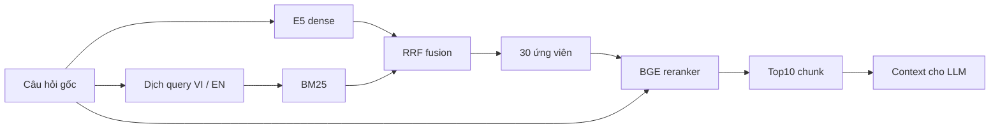

# Phần báo cáo của Huy — Tokenization, embedding và retrieval

Bản nội dung ngày 22/10/2026 cho Review 2. Kết quả chính lấy từ heldout-review2-v1, revision reviewed-r1; thí nghiệm cũ được trình bày riêng theo đúng dữ liệu và định nghĩa metric. Phần này có thể đưa vào báo cáo chung; kết quả generation do người phụ trách LLM bổ sung.

## 1. Mục tiêu và phạm vi đóng góp

Retrieval phải cung cấp đủ bằng chứng để LLM trả lời câu hỏi nghiệp vụ. Khó khăn của nhóm gồm tài liệu nhiều định dạng, nội dung bảng, câu hỏi khác ngôn ngữ tài liệu và đáp án cần ghép nhiều đoạn.

Huy phụ trách kiểm soát tokenizer/encoder, embedding và index tương thích, dense/lexical retrieval kết hợp dịch query và reranker, cùng bộ đánh giá có nhãn bằng chứng và khả năng chạy lại. Parser tiếp nhận từ luồng xử lý tài liệu của nhóm; không suy chất lượng OCR hoặc generation từ điểm retrieval.

Hệ thống sử dụng pretrained models. Không fine-tune embedding/reranker/LLM trong các phép đo này, nên không có learning rate, optimizer, epoch hoặc loss curve huấn luyện để báo cáo.

## 2. Dữ liệu và tokenization

### 2.1. Corpus đánh giá

Corpus gồm năm tài liệu nghiệp vụ mô phỏng VietStyle Commerce và năm bản EN tương ứng. Đây là dữ liệu mô phỏng/historical, không phản ánh tồn kho hiện hành.

| Tài liệu | Định dạng | Chunk VI | Chunk EN |
|---|---|---:|---:|
| Inventory Management Policy Manual | DOCX |18|19|
| SOP Cycle Count and Stock Adjustment | PDF |9|7|
| Policy Rules Registry | CSV |12|12|
| Inventory Control and Reorder Planner | XLSX |485|485|
| Inventory Policy Training Deck | PPTX |8|8|
| **Tổng** | **5 tài liệu/ngôn ngữ** |**532**|**531**|

Workbook đóng góp970/1.063 chunk, tương đương91,25%; phân bố theo loại tài liệu không cân bằng dù số file mỗi định dạng bằng nhau. Bộ câu hỏi được chia đều theo nhóm để không chỉ xem điểm tổng. Chưa oversample corpus vì nhân bản chunk có thể thay đổi thứ hạng và thống kê BM25.

Corpus, parser output, vectors, câu hỏi và nhãn được lưu cùng package. Đây là số đếm của snapshot benchmark, không phải toàn bộ dữ liệu nền tảng. Mốc rollout production21/10 ghi nhận5 tài liệu VI/532 vector E5; không đồng nhất với corpus thí nghiệm song ngữ.

### 2.2. Vì sao phải kiểm tra tokenizer và encoder

Ký tự không tương đương token. Đoạn đạt ngưỡng ký tự parser vẫn có thể vượt cửa sổ encoder và bị cắt mất phần chứa đáp án. Kiểm toán ban đầu trên 532 chunk phát hiện460 chunk (86,47%) vượt mức MiniLM mặc định256 token dù cấu hình ứng dụng ghi512. Đây là nguy cơ truncation trong cấu hình, không phải bằng chứng460 câu trả lời đã sai.

Cách xử lý hiện có:

- TokenCounter dùng cùng model ID/revision với encoder.
- EmbeddingService đặt trực tiếp encoder.max_seq_length từ cấu hình và kiểm tra giới hạn kiến trúc.
- Chunk quá dài được chia tiếp bằng tokenizer; dự phòng special tokens và prefix trước embedding.
- Với E5 encoder512, service dành4 token cho prefix, truyền ngân sách508 vào bộ chia; bộ chia tiếp tục trừ special tokens. Không xem508 là số token văn bản thuần luôn được phép nhập.
- Giữ giới hạn trong khả năng model, không tăng tùy ý để tránh cắt.

Parser văn bản có cấu hình theo câu với mục tiêu1.100 ký tự. Overlap120 ký tự áp dụng cho splitter fixed, không có nghĩa mọi chunk câu/bảng đều overlap120. Bước chia token có overlap mặc định32; nhánh chia body sau header dùng overlap thích ứng không quá32. Chưa có ablation để gọi các giá trị này tối ưu.

Nếu bảng dài phải chia, header Section/Table/Columns được giữ để đoạn sau vẫn biết giá trị thuộc trường nào. Header cũng tiêu tốn token; nếu header không còn chỗ cho nội dung thì báo lỗi. Overlap/header giúp giữ ngữ cảnh nhưng không bảo đảm retrieval lấy đủ hai dòng/chunk liên quan.

### 2.3. Tổng token E5 trên snapshot

Đã đếm lại bằng cached tokenizer E5 đúng revision, không inference lại hoặc đổi vector. Số token dưới tính sau prefix passage và special tokens:

| Corpus | Tổng token đầu vào | Chuỗi ngắn nhất | Chuỗi dài nhất | Vượt 512 |
|---|---:|---:|---:|---:|
| VI |224.845|37|476|0|
| EN |224.358|49|476|0|
| **Tổng** |**449.203**|—|**476**|**0/1.063**|

Tổng tính cả header/overlap lặp, không phải số token duy nhất của tài liệu gốc. Query tối đa50 token E5. Cận trên bảo thủ cho cặp BGE là521/1.024 token. Không phát hiện truncation trong bộ đã chạy. Dữ liệu đếm và cấu hình ở [retrieval-report-stats.json](retrieval-report-stats.json).

## 3. Embedding, schema và pipeline

### 3.1. Cấu hình embedding

Model hiện dùng: intfloat/multilingual-e5-base, revision d128750597153bb5987e10b1c3493a34e5a4502a, vector768 chiều, L2 normalization, giới hạn512. Service tự thêm query: cho câu hỏi và passage: cho đoạn tài liệu; caller không thêm lặp prefix.

Pilot trước trên 5 tài liệu VI/532 chunk/20 câu hỏi có expected-source recall@10:

| Model | Expected-source recall@10 |
|---|---:|
| all-MiniLM-L6-v2 |80,00%|
| multilingual-e5-base |93,33%|
| BGE-M3 |89,17%|
| Qwen3-Embedding-0.6B |86,67%|
| e5-large-v2 |78,33%|

Pilot chỉ đo tìm đúng file nguồn, chưa đo có đủ đáp án; không so trực tiếp93,33% với Recall của bộ mới. Pilot hỗ trợ chọn E5-base cho Commerce, không chứng minh tốt nhất mọi miền; phép thử tài liệu tài chính khác cho thứ tự model khác.

intfloat/e5-large-v2 trong proposal và intfloat/multilingual-e5-base đang dùng là hai model khác nhau. Khi đổi model phải embedding lại index và kiểm tra dimension/prefix/normalization, không chỉ đổi model query hoặc ép chiều vector. Migration hiện kiểm tra index E5 và dùng vector(768).

### 3.2. Schema và provenance

Luồng lưu trữ: documents → document_parser_chunks → document_chunks + embedding.

documents giữ danh tính, nguồn, trạng thái, quyền. document_parser_chunks giữ đầu ra parser; document_chunks giữ nội dung cuối, thứ tự, metadata và vector. Không dùng chunk index đơn lẻ làm ID xuyên tài liệu.

| Nhóm | Trường tiêu biểu | Vai trò |
|---|---|---|
| Danh tính/quyền | document_id, filename; company, allowed_roles | Xác định nguồn và scope/ACL |
| Vị trí | page_number, section_title, table_index, table_row_start/end | Kiểm đúng trang/bảng/hàng |
| Ánh xạ nguồn | source_parser_index, source_content_sha256, source_spans | Truy ký tự chunk về parser output |
| Chuẩn bị embedding | embedding_model, token_count, embedding_max_sequence_length | Theo dõi cấu hình tạo index |
| Manifest thực nghiệm | model/revision, dimension, normalize, prefixes, hashes | Xác định vector/query/corpus thực dùng |

source_spans dùng khoảng ký tự Unicode [start,end), không phải byte hoặc token index. Separator do hệ thống sinh không được tính là ký tự bằng chứng gốc. Nhờ đó có thể chấm evidence khi một đoạn nguồn bị chia qua nhiều chunk.

Lưu ý provenance: metadata corpus JSONL giữ từ snapshot chuẩn bị trước và còn nhãn model Qwen. **Ma trận vector thực dùng trong run là E5 768 chiều**, đã kiểm hash trùng candidate E5 gốc và pinned protocol. Không dùng nhãn metadata cũ để suy model của ma trận candidate mới. Thống kê token cũng đã đếm lại bằng E5, không cộng token_count cũ. Giữ snapshot hiện tại để bảo toàn hash; cần chuẩn hóa metadata khi tạo phiên bản dữ liệu tiếp theo.

### 3.3. Các cấu hình đối chiếu

| Cấu hình | Vai trò | Xử lý |
|---|---|---|
| Dense E5 | Đối chứng1 | Query gốc → E5 → tìm vector |
| Dense E5+BGE | Đối chứng2 |30 dense candidates → BGE → top 10|
| Translated hybrid | Ablation trước rerank | Dense gốc + BM25 query đã dịch → RRF → top 10|
| Translated hybrid+BGE | Pipeline đề xuất |30 fused candidates → BGE → top 10|

Hai đối chứng đã chạy trên dữ liệu nhóm. Bảng đối chiếu hai paper gốc với dataset/metric phù hợp còn là hạng mục riêng; không gọi bảng trên là hoàn tất tái dựng hai paper.



Dense embed query gốc. Groq translator tạo query VI/EN để bổ sung lexical, không dịch toàn kho tài liệu. Trong thí nghiệm, document-language mapping được xác minh; mỗi ca tìm trên 5 tài liệu ngôn ngữ đích. Scope/ACL áp dụng trước khi cắt ứng viên.

RRF kết hợp thứ hạng, không cộng trực tiếp cosine với BM25 score: đóng góp của rank r là w/(60+r). Hai danh sách lexical được fuse trước, sau đó kết hợp dense với trọng số dense1/lexical2, k60. Trong cấu hình rerank top 10, mỗi nhánh tìm tới 300 rồi cắt fused list còn 30.

BGE là model riêng: BAAI/bge-reranker-v2-m3, revision 953dc6f6f85a1b2dbfca4c34a2796e7dde08d41e. CrossEncoder chấm cặp query gốc–chunk gốc. Run dùng FP32, batch 4, cap 1.024 token/cặp, raw logits và giữ thứ tự khi hòa điểm. Nó chỉ sắp lại ứng viên, không tạo thêm đoạn ngoài pool.

Nếu dịch lỗi, implementation dùng scoped dense candidates rồi vẫn rerank, ghi fallback. Run này dịch40/40 không lỗi nên không đo tần suất hoặc chất lượng fallback trong sự cố API.

### 3.4. Trạng thái tích hợp

Service/API có lựa chọn translated_hybrid_rerank; mặc định vẫn hybrid. Service/RAG nội bộ nhận document IDs và verified language map. HTTP/UI chưa cấp language map; thiếu map thì hai query lexical tìm trên cùng corpus được phép, không tự đoán ngôn ngữ.

Reranker production mặc định CPU và chỉ đọc model cache; cấu hình RERANKER_DEVICE=cuda mới chuyển sang GPU. Run benchmark này cố định CUDA, không đại diện mọi máy triển khai.

Do đó, kết quả language-aware có kiểm soát không đại diện production không scope. Benchmark dùng SQL production trên TEMP tables, không đổi vector public khi đo. Đủ evidence ở top 10 chưa bảo đảm evidence còn đủ sau context packing của generation.

## 4. Thiết kế đánh giá

Bộ cũ fresh-reviewed-v1 gồm 12 ý/24 văn bản/48 ca đã được dùng để xem lỗi và cải tiến, nên giữ làm development/regression. Bộ chính mới được chốt trước inference:

- 20 ý hỏi, mỗi ý VI và EN:40 văn bản.
- Mỗi văn bản tìm trên corpus VI/EN:80 ca theo VI→VI,VI→EN,EN→VI,EN→EN.
- 4 nhóm, mỗi nhóm 5 ý: văn bản; bảng/quy tắc/số liệu; ghép hai chunk; diễn đạt lại/thuật ngữ.
- 61 thành phần evidence bắt buộc,148 source spans;40 cặp intent/ngôn ngữ qua kiểm tra full-corpus đủ và rỗng không đủ.
- 10 kiểm tra intent/ngôn ngữ nhóm multi-chunk xác nhận một chunk chưa đủ, một cặp phù hợp đủ.
- H10 đổi sang câu SOP không-chênh-lệch; H13/H19 sửa cách hỏi trước inference.

Nhãn do trợ lý hỗ trợ soạn/đối chiếu; người dùng xem rà soát rồi duyệt hướng sửa. Chưa double annotation độc lập/Kappa. Cùng corpus đã biết và có chủ đề gần bộ cũ, nên không xem đây là bằng chứng generalization sang doanh nghiệp chưa thấy.80 ca không phải80 câu độc lập.

Translator chỉ thấy câu gốc; không dùng câu EN đã soạn làm bản dịch oracle cho VI.40 bản dịch được lưu một lần, dùng lại mọi nhánh/lần chạy. Không sửa nhãn hoặc dịch theo kết quả mất điểm.

### Metric

P@10 là số gold chunk trong top 10 chia10; Recall@10 là tỷ lệ gold chunk đã tìm. MRR@10 dùng nghịch đảo vị trí gold đầu tiên trong top 10; nDCG@10 đánh giá thứ tự với relevance nhị phân.

Gold chunk có giao ký tự nguồn không trắng với span bắt buộc, bao gồm nguồn thay thế và span bị chia. Nhãn không phủ hết mọi cách dẫn chứng ngoài các đoạn đã gán. Chạm một span chưa chắc đủ đáp án, nên bổ sung Full evidence@10 (đủ mọi thành phần bắt buộc, chấp nhận alternatives) và Component coverage@10 (tỷ lệ thành phần đủ; báo macro theo ca và tổng đạt/tổng).

Một nguồn thay thế có thể đủ trả lời nhưng Recall chưa100% vì chưa lấy hết mọi gold chunk. Trần P@10 trung bình theo nhãn là15,5%, không phải100%; không diễn giải P@10=0,1338 thành86,62% context sai.

Các nhánh cùng corpus/E5/nhãn/scope/k/runtime. Seed 20261022 dùng cho thứ tự nhánh và phân tích, không phải seed training. Mỗi ca/nhánh một pass; chưa3 lần độc lập để báo mean±std giữa run. Bootstrap theo 20 intent là phân tích bổ sung, không thay đo lặp.

## 5. Kết quả

### 5.1. Kết quả80 ca

| Phương pháp | P@10 | R@10 | MRR@10 | nDCG@10 | Đủ bằng chứng@10 | Thành phần đạt |
|---|---:|---:|---:|---:|---:|---:|
| Dense E5 | 0.0963 | 0.6562 | 0.5586 | 0.5594 | 52/80 (65.00%) | 156/244 |
| Dense E5 + BGE | 0.1188 | 0.7875 | 0.8213 | 0.7731 | 62/80 (77.50%) | 189/244 |
| Translated hybrid | 0.1188 | 0.7917 | 0.6590 | 0.6694 | 63/80 (78.75%) | 187/244 |
| Translated hybrid + BGE | 0.1338 | 0.8823 | 0.9000 | 0.8635 | 69/80 (86.25%) | 208/244 |

Pipeline cuối đủ bằng chứng69/80, so với52/80 dense: thêm 17 ca, **+21,25 điểm phần trăm**. Recall tăng0,6563→0,8823; không gọi mức tăng Full evidence là mức tăng Recall.

So với dense+BGE: thắng8, thua1, tăng ròng7 ca (+8,75pp). So với translated hybrid thô: reranker cứu6 ca và không mất ca đủ evidence; MRR tăng0,6590→0,9000. Đây là cải thiện pipeline khi embedding giữ nguyên.

Bootstrap10.000 lần theo 20 intent, seed 20261022: gain Full evidence so với dense+21,25pp, CI95%[10,00;35,00]; so với dense+BGE+8,75pp,CI[0,00;20,00]. Khoảng sau chạm0, nên chưa nói chắc vượt dense+BGE trên mọi tập. Bộ mới không có original-query hybrid arm, chưa tách lợi ích riêng của dịch khỏi BM25/fusion.

### 5.2. Theo hướng ngôn ngữ

| Query → tài liệu | Dense | Dense+BGE | Translated hybrid | Translated hybrid+BGE |
|---|---:|---:|---:|---:|
| VI→VI |16/20|16/20|16/20|17/20|
| VI→EN |9/20|15/20|15/20|17/20|
| EN→VI |12/20|15/20|16/20|17/20|
| EN→EN |15/20|16/20|16/20|18/20|

Các ô là số ca đủ bằng chứng, không phải Recall. Gain vsdense lớn nhất ở VI→EN:9→17/20.8 ý tra số liệu giữ tên cột tiếng Anh/cùng dòng số liệu giữa hai corpus;6 ý có cả chunk giống hệt. Không gọi toàn bộ 80 ca là thử nghiệm dịch chéo thuần túy trên tài liệu hoàn toàn đơn ngữ.

### 5.3. Theo loại câu

| Nhóm | Dense | Dense+BGE | Translated hybrid | Translated hybrid+BGE |
|---|---:|---:|---:|---:|
| Văn bản |17/20|20/20|19/20|19/20|
| Bảng/quy tắc/số liệu |14/20|16/20|16/20|18/20|
| Ghép nhiều chunk |6/20|9/20|9/20|12/20|
| Diễn đạt lại/thuật ngữ |15/20|17/20|19/20|20/20|

Multi-chunk tăng6→12/20 nhưng vẫn yếu nhất ở60%. Header/overlap không tự giải quyết việc phải tìm đủ nhiều dòng.

## 6. Latency và tính khả thi

Run dùng RTX2060, FP32, batch 4, cached models và production SQL trên snapshot TEMP tables.

| Phương pháp | Trung bình | Median | p95 |
|---|---:|---:|---:|
| Dense E5 |0,546 s|0,488 s|0,941 s|
| Dense+BGE |1,691 s|1,549 s|2,416 s|
| Translated hybrid |2,437 s|2,370 s|3,165 s|
| Translated hybrid+BGE |3,609 s|3,578 s|4,605 s|

Latency gồm encode+retrieve+rerank tương ứng, chưa gồm khởi tạo model, live API dịch hoặc generation. Encode đo một lần cho40 văn bản, dùng chung hai corpus đích. Nhánh hybrid thô là giai đoạn trước rerank của cùng luồng, không phải một phép đo timing độc lập.

API dịch đo riêng lúc chuẩn bị:40/40 thành công, trung bình0,560 s. Không cộng hai số trung bình khác giai đoạn rồi gọi end-to-end đã kiểm chứng. Cần timestamp từ nhận câu tới trả lời hoàn tất; streaming thêm thời gian tới token đầu.

File trọng số model.safetensors trong cache: E5-base 1.060,68 MiB; BGE 2.165,86 MiB, chưa gồm tokenizer/config/mọi file cài đặt. Peak PyTorch allocated ghi trong run2,212 GiB, không phải toàn bộ VRAM desktop/driver. Runner giải phóng E5 trước khi nạp BGE; peak này không đại diện production giữ nóng đồng thời cả hai. Throughput, tải đồng thời và cold-start chưa được đo.

## 7. Phân tích11 ca mất điểm

Đã kiểm toàn bộ 11 ca thiếu evidence, không chọn riêng vài ví dụ. SQL replay bằng vectors/bản dịch đã lưu cho11/11 top 30 khớp run. Tất cả11 đã thiếu từ pool 30, không có ca pool đủ nhưng reranker làm mất trong top 10.

| Ca lỗi | Số ca | Vị trí bằng chứng |
|---|---:|---|
| H04 VI→EN: hồ sơ lưu trữ |1|dense 19; ngoài lexical 300; fusion 33|
| H08 trên corpus VI: ID19 |2|lexical46/68; fusion84/72|
| H11: ghép ID1 và3 |4|ID3 ở fusion211–354|
| H14: ghép ID8 và9 |4|ID9 ở fusion42–200|

H04 dịch “hồ sơ lưu trữ” thành “mandatory file categories/storage”, lệch “required records/retention”. Dense+BGE thành công nhưng fusion đẩy chunk xuống33 và cắt trước BGE. Đây là hồi quy thực. Có dấu hiệu thuật ngữ dịch và cơ chế cắt pool cùng ảnh hưởng; chưa có ablation để quy toàn bộ cho riêng dịch.

Ở bảng, các tên cột/giá trị lặp nhiều; matching từ/embedding chưa bảo đảm đúng quan hệ Product ID→hàng. BGE không thể cứu dòng chưa được xem. Tăng pool 30→50 có thể giúp vài ca nhưng không giải quyết gold ngoài 200.

Sau Review2, ưu tiên tra đúng cột Product ID, tách query nhiều ID rồi ghép candidate, bảo toàn ID/tên trường qua dịch và rà thuật ngữ nghiệp vụ. Chưa triển khai hoặc sửa nhãn bộ này theo lỗi model.

## 8. Tái lập và bàn giao

Run lưu results/config/CSV/query vectors/logits/verification. Đã kiểm lại80 thứ hạng, evidence/metric và4.800 logit entries. Manifest SHA256:3f424cac026e098fb2cff98c03137e74e61cf48b7e4a219c503312a60b1a6a14. Dùng cùng prepared/ và tên mới khi inference lại.

Tái lập điểm bằng backend SQL. Adapter offline phá hòa BM25 theo chuỗi chunk ID, SQL theo numeric row ID; diagnostic11 ca chỉ1/11 top 30 trùng hoàn toàn. Không trộn điểm/latency offline với SQL; không sửa frozen code sau khi xem điểm.

Các hạn chế: corpus mô phỏng nhỏ đã biết, nhãn chưa kiểm định nhiều annotator độc lập, bảng dùng nhiều header EN, scope biết trước5 tài liệu đích/admin, một pass/nhánh, thiếu ablation tách dịch với lexical/fusion. Chưa đo hallucination/refusal/RBAC/OCR hoặc generation/end-to-end.

Generation hiện có cap đóng gói context5.000 ký tự. Top10 đủ evidence chưa bảo đảm prompt cuối đủ. Diagnostic development tái lập citation validator chấp nhận source ID từ context đã bị packing loại với mocked LLM; đây là lỗi để An kiểm tra, không phải tỷ lệ lỗi LLM đo trên 80 ca.

### Trước và sau trong phần Huy

| Trước | Hiện tại |
|---|---|
| Config token limit có thể khác encoder | Dùng chung tokenizer/revision, đặt encoder limit và chia theo token |
| Tìm đúng file chưa chứng minh có đáp án | Source spans + thành phần bắt buộc/alternatives, chấm đủ evidence |
| Dense một danh sách | Thêm translated lexical query, RRF và BGE tùy chọn |
| Query/index có thể lệch model | E5 index768 chiều, prefixes/normalization và migration kiểm soát |
| Kết quả rải nhiều nơi | Bundle mới có input/config/hash/run; mục lục/archive có nhật ký |
| Bộ nhỏ dùng cả phát triển/kết luận | Giữ bộ cũ development; bộ mới chốt trước inference, công khai hạn chế |

Cải tiến runtime đã có trên Huy trước mốc này; đợt22/10 tập trung đánh giá, lưu artifact và báo cáo, không đổi production code để tối ưu theo test mới.

### Hạng mục Review2 còn thiếu

Hai đối chứng/pipeline đã chạy; retrieval metrics, failure analysis, token totals, latency/weight size có nguồn. Chưa hoàn tất paper-vs-group trên dữ liệu/metric tương thích,3 run/seed độc lập hoặc khảo sát rộng chunk size/overlap. Ghi đang làm/chưa làm, không điền số giả.

An/LLM owner cần chấm câu trả lời trên cùng ca, context thực sau packing, citations, faithfulness, relevancy, hallucination/refusal và generation/end-to-end latency. Data/parser owner bổ sung nguồn/size raw files, cleaning và OCR quality. Deployment owner xác nhận clean-machine Compose và lịch sử CI thật. Có module code chưa chứng minh microservices/deployment hoàn tất.

## 9. Nguồn và lệnh chạy lại

- [Bộ mới](../../artifacts/evaluation/heldout-review2-v1/README.md), [câu hỏi/evidence](../../artifacts/evaluation/heldout-review2-v1/REVIEW.md), [protocol](../../artifacts/evaluation/heldout-review2-v1/protocol.json).
- [Run report](../../artifacts/evaluation/heldout-review2-v1/runs/review2-reviewed-r1-sql-20261022/REPORT.vi.md), [metrics](../../artifacts/evaluation/heldout-review2-v1/runs/review2-reviewed-r1-sql-20261022/metrics.csv), [SQL diagnostics](../../artifacts/evaluation/heldout-review2-v1/runs/review2-reviewed-r1-sql-20261022/candidate-diagnostics.json).
- [Pilot embedding](../../artifacts/evaluation/embedding-comparison-20261018/comparison.md), [development](../../artifacts/evaluation/fresh-reviewed-v1/), [context/citation diagnostic](../../artifacts/evaluation/retrieval-metrics-20261022/REPORT.vi.md).
- [Token counter](../../src/core/tokenization/token_counter.py), [embedding chunker](../../src/core/tokenization/embedding_chunker.py), [embedding service](../../src/core/embeddings/embedding_service.py).
- [Retrieval service](../../src/core/retrieval/retrieval_service.py), [translated hybrid](../../src/core/retrieval/methods/translated_hybrid.py), [reranker](../../src/core/retrieval/reranker.py), [integration](../translated-hybrid-rerank.md).
- [Proposal](../proposal.docx), [Review2 checklist](review2-task2-checklist.docx).

Từ gốc project, kiểm artifact đã lưu, không inference mới:

```bash
.venv/bin/python artifacts/evaluation/heldout-review2-v1/run.py verify-run   artifacts/evaluation/heldout-review2-v1/runs/review2-reviewed-r1-sql-20261022
```

Inference mới, giữ cùng input/bản dịch và không ghi đè:

```bash
.venv/bin/python artifacts/evaluation/heldout-review2-v1/run.py run   --name review2-reviewed-r1-sql-repeat-02
```

Cần model cache, CUDA, thư viện tương thích và DATABASE_URL cho SQL. Khi prepared/ đủ thì không cần gọi Groq lại. Package này chạy retrieval, không tự chạy generation.
