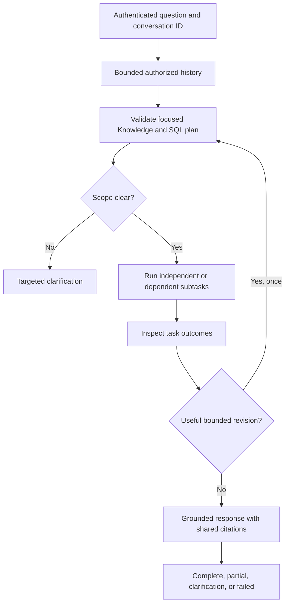

# Knowledge and SQL orchestration: implementation and validation

Date: 2026-10-29 (Asia/Saigon).
Scope: unified automatic Knowledge/SQL orchestration in this repository.
This document accompanies the [frontend API contract](agent-api-frontend-contract.md),
the [approved capability map](../../CAPABILITY-MAP-agent-orchestration.md), and
the [implementation task record](../../tasks/todo.md).

Delivery note: temporary verification helpers, logs, and generated evaluation
output are intentionally excluded from the main push. Artifact paths below refer
to local validation evidence. Permanent benchmark fixtures and regression tests
are included. See the [Report follow-up verification](report-source-orchestration.md#final-verification-and-delivery)
for the later real Report run, script checks, and Docker update.

## Problem and accepted scope

**Approved Report follow-up (2026-10-29):** Report's separate interface now uses
the same Knowledge/SQL graph for Auto source collection. `orchestrated` replaces
the UI's Combined option; `combined` is an API alias. This supersedes the original
source-collection exclusion below, while automatic chat still cannot select Report
or Dashboard. See [Report behavior, API, limits, and tests](report-source-orchestration.md).
The user also authorized committing/pushing to main and updating local Docker;
earlier no-push statements below describe the preceding validation stage.

Previously automatic and agentic modes selected agents differently. A hybrid
request sent the entire original question to both Knowledge and SQL. A question
containing a document lookup, a calculation, and a dependent policy condition could
therefore produce invalid SQL, an irrelevant retrieval question, or an unnecessary
clarification. The graph did not inspect results and revise the remaining work;
auto hybrid answers simply concatenated agent prose.

The approved change unifies Auto and Agentic for **Knowledge and SQL only**.
Report and Inventory Dashboard remain explicit standalone modes. Their underlying
generation, template, authorization, and dashboard behavior are not reimplemented
or automatically selected by the new planner. Earlier specs proposing four-agent
planning/report handoffs were superseded by the user's scope amendment.

The user additionally requested automatic demo startup, a complete final document,
a frontend integration contract, and same-model Groq API-key failover on rate limits.

## Resulting workflow



The implementation remains one compiled LangGraph workflow in the API process.
There are no new services, package dependencies, database migrations, autonomous
write tools, or production deployment changes.

### Selection and decomposition

`auto` is the canonical request mode. Existing `agentic` requests call the same
workflow, and both use the same planning prompt, models, execution limits, and
response assembler. Explicit Knowledge/SQL selections bypass multi-agent planning.
Explicit Report and Dashboard continue through their existing standalone agent.

The planner receives the original question, recent scoped conversation context,
and the current allowlisted SQL schema. It returns a Pydantic-validated objective
and up to four focused tasks, or a targeted clarification. Allowed task agents are
only `knowledge` and `sql`. Tasks contain IDs, focused questions, dependency IDs,
and typed references to predecessor rows or evidence. Plans cannot supply identity,
permissions, executable SQL, unknown fields, missing dependency IDs, or cycles.

For example, a request to count products and find guidance for their categories
becomes a SQL category task followed by a focused document lookup using returned
categories. A policy-threshold calculation retrieves cited policy evidence before
dispatching the SQL task. Independent document and data questions can run together.
Each specialist gets its own question rather than a copy of the full mixed request.

Planning errors permit one bounded repair. Narrow deterministic single-specialist
fallbacks are available for unambiguous requests when the provider is unavailable.
A failed mixed decomposition never falls back to broadcasting the entire question
to both agents. Broad keyword rules no longer replace a valid generated plan.

### Context and follow-ups

Conversation context is stored in process memory, keyed by verified user subject
and conversation ID. A permission/role fingerprint invalidates old context after a
scope change. Same-conversation requests serialize; independent conversations can
proceed concurrently. Cancelled waiters release their bookkeeping.

Limits are six retained exchanges, 12,000 characters, 30-minute idle expiry, and
100 conversations per process. Active entries are not evicted to create a second
lock for the same conversation. No conversation ID means a stateless request.

Stored context contains question/scope summaries and clarification text, not SQL
row dumps or document bodies. Earlier assistant claims do not become new source
evidence. A missing referent must be clarified or retrieved again.

The Streamlit and bundled web clients generate conversation IDs and reset them on
New conversation/sign-out. This is prototype process-local memory: restart,
eviction, or routing to another worker can lose continuity. Durable distributed
history is not implemented.

### Execution and recovery

Subrequests copy the original server-verified identity and accepted retrieval
settings. Dependencies carry bounded structured values with source provenance;
they are not substituted into raw SQL. Existing SQL generation/AST validation and
read-only repository execution remain responsible for query safety.

Outcomes distinguish complete, partial, empty, clarification-required, failed,
timed-out, and blocked tasks. Empty or failed predecessors block descendants.
Independent successful findings survive sibling failure. A plan revision cannot
alter completed tasks, discard their successful findings, or silently drop a
required specialist. Repeating an unchanged failed question makes no progress and
does not dispatch it again.

| Budget | Limit |
|---|---:|
| Tasks per plan | 4 |
| Specialist invocations across original/revised plans and retries | 6 |
| Concurrent specialist tasks | 2 |
| Retry per task for transient failures | 1 |
| Execution-driven plan revision | 1 |
| Planning/repair call | 15 seconds |
| Specialist invocation | 60 seconds |
| Synthesis | 20 seconds |
| Entire automatic request, including conversation lock waiting | 120 seconds |

Every stage is capped by remaining request time. Provider SDK calls use finite
timeouts and disable hidden retries. Synchronous worker slots remain occupied
until their real thread exits, even when the async caller times out; the shared
worker budget is eight outstanding calls. Async siblings are cancelled and joined
on failure/cancellation. This is cooperative bounded execution, not the ability to
forcibly terminate arbitrary Python/native code running in a thread.

### Grounding and partial answers

Evidence IDs from different agents are remapped to unique response-wide `S#`
references before synthesis. The assembler supplies rows, document excerpts,
scope, limitations, and task outcomes as untrusted data. It checks citation
membership, declared task/source coverage, and unsupported numerical tokens.

These checks detect some invalid drafts; they do not establish full semantic
entailment or prove that a number was assigned to the correct business meaning.
Reviewed live examples remain necessary. The planner is also model-assisted:
scope-preservation instructions and tests do not guarantee perfect decomposition
for every unseen natural-language request.

If synthesis is unavailable or invalid, the response displays cited document
excerpts/SQL findings and explicit gaps. It does not blindly join unvalidated
agent prose. A partial response has `ok: false`; HTTP 200 alone never means that
the user's complete task succeeded. `fallback` distinguishes an evidence fallback
from generated synthesis.

SQL rows and authorized query diagnostics remain inspectable. Automatic results
use `data.sql`, `data.knowledge`, and additional `task:<id>` groups. Explicit SQL
retains top-level data. Citation IDs must be resolved from the same response.
The frontend contract documents these differences and all status transitions.

## Same-model Groq failover

The provider uses the primary `GROQ_API_KEY` plus optional numbered backups such as
`GROQ_API_KEY_2`. Duplicate keys are removed. On a Groq HTTP 429/`RateLimitError`,
it marks that key as cooling down and tries another configured key using exactly
the same model, temperature, reasoning mode, prompt, and token budget. Other
failures do not trigger credential rotation. All attempts share the request deadline.

A successful backup remains preferred for subsequent calls. If all keys are
cooling down or exhausted, the provider fails explicitly rather than looping.
No key values are returned in results, logs, test summaries, or this document.
An explicitly supplied test/evaluation key limits that provider instance to the
supplied credentials. The dedicated RAGAS key is not silently added to general
runtime rotation.

Failover does not create additional quota when keys share a provider quota pool.
The initial rapid benchmark exhausted available capacity; a paced run is recorded
separately instead of overwriting or hiding the failure artifacts. The model stays
`qwen/qwen3.8-27b` where that is the configured runtime model.

## Security and API boundaries

- Server identity and specialist authorization are enforced before tool dispatch.
  Knowledge also fails closed at its own answer/retrieval boundaries when verified
  document scope is missing; SQL retains its existing permission checks.
- Client metadata cannot inject identity, roles, history, plans, predecessor
  results, deadlines, or budgets. Both API request models validate reserved fields.
- Plans, prior turns, retrieved content, and predecessor results remain untrusted
  data. A denial is not retried through another role or transformed into a broader
  retrieval/query scope.
- Traces contain task IDs, agent names, dependencies, attempts, statuses, durations,
and error types. Persisted telemetry does not acquire raw questions, row data,
  prompts, or document excerpts through this change.
- Routing/status authority is request-local graph state and result metadata.
  `last_destination` remains a compatibility convenience, not a concurrent-request
  telemetry source.
- The Vercel-facing endpoint remains authenticated `/api/agents/chat`. Authentication
  and rewrite configuration are not replaced. Report file endpoints remain separate.

## Files and responsibilities

| File | Responsibility |
|---|---|
| `src/core/models/agent_plan.py` | Typed focused tasks, result references, dependency validation |
| `src/core/agents/planning.py` | Context-aware plan generation, repair, narrow fallback |
| `src/core/agents/router.py` | Shared auto/agentic graph and standalone dispatch |
| `src/core/agents/execution.py` | Authorization, dependencies, outcomes, attempts, trace |
| `src/core/agents/response.py` | Citation mapping, synthesis checks, supported fallback |
| `src/core/agents/runtime.py` | Request-local deadlines and bounded sync work |
| `src/core/agents/conversation_context.py` | Scoped, bounded process-local history and locks |
| `src/core/prompts/` | Centralized instruction templates; see its prompt catalog |
| `src/core/llm/groq_provider.py` | Finite provider calls and same-model key failover |
| `src/app/agents.py`, `src/core/agents/main.py` | API validation/defaults/status integration |
| `src/core/agents/streamlit_ui.py`, `src/app/static/` | Unified controls, conversation IDs, result states |
| `data/evaluation/orchestration_cases.json` | 24 bilingual scenario contracts |
| `scripts/agents/benchmark_router_25.py` | Fresh-output unified graph benchmark |

## Verification record

The pre-change focused baseline passed 25 tests: router 3, analytics 4, API 9,
report 1, and Streamlit 8. New tests were first run failing before their respective
implementation slices. Coverage includes decomposition, both dependency directions,
history isolation/expiry/capacity/cancellation, authorization, forged metadata,
replanning limits, partial outcomes, invalid citations/numbers, provider key
failover, and API/client compatibility.

The 24 EN/VI scenario fixtures exercise deterministic graph contracts with fake
providers and specialists. They do not measure whether a live model can infer all
24 plans. Live planning and end-to-end execution are measured separately.

The complete repository suite was attempted. It already has unrelated failures
and missing historical modules/fixtures. To distinguish those from regressions,
the original HEAD versions of changed tracked modules/tests were loaded through
an import hook while reusing the same unchanged fixture paths, then compared with
the current suite by failing test identity. Detailed final counts and outstanding
live acceptance checks are recorded in the completion addendum below.

Standalone report and dashboard checks remain regression tests. The new workflow
does not claim a new Report/Dashboard orchestration capability.

## Local demo and reproduction

The agent demo is `src/core/agents/streamlit_ui.py`. It authenticates to the backend
and uses `/api/agents/chat`; Report/Dashboard remain selectable standalone options.
The backend runs locally through the existing Docker Compose backend service,
using its private model services. Only that local backend image was rebuilt for
the changed source; no production or Vercel deployment was performed.

```powershell
$env:PYTHONPATH = 'src'
.\.venv\Scripts\python.exe -m streamlit run src/core/agents/streamlit_ui.py --server.address 127.0.0.1 --server.port 8501 --server.headless true
.\.venv\Scripts\python.exe scripts/agents/benchmark_router_25.py --configuration unified --output artifacts/evaluation/router-unified-NEW-RUN --interval 15
```

Run the server command as a long-running process; do not start a duplicate listener.
The benchmark requires a fresh output directory and refuses historical overwrites.
Use the existing authenticated demo accounts without printing credentials.

The available browser automation surface reported no browser. Streamlit's official
AppTest harness therefore verifies the rendered application widgets, real sign-in,
Auto default, New conversation reset, and absence of application exceptions. This
is not a screenshot/layout or actual-browser compatibility test. Backend HTTP and
Streamlit health checks are separate from that harness.

## Remaining limits

Prompt organization follow-up (2026-10-29): 13 embedded templates were moved to
[`src/core/prompts`](../../src/core/prompts/README.md), including planning/repair,
analytics/synthesis, SQL, report, translation, extraction, evaluation, and smoke
instructions. Exact rendered-string comparisons preserved wording, whitespace,
Unicode, and JSON braces. Callers, benchmark prompt hashes, and Colab bundle inputs
were updated. The full suite still has the same 64 pre-existing failing identities
and no new failures. Historical evaluation artifacts were not rewritten.

This remains a bounded prototype, not an unrestricted autonomous agent. It cannot
invent missing schema fields, policy thresholds, causal evidence, or unavailable
documents. Provider quota/key exhaustion can prevent planning or completion even
when deterministic orchestration works. Process-local history is not durable.
Mechanical citation/numeric checks are not a complete faithfulness evaluator.
Remote Vercel integration and production capacity remain unverified.

## Completion addendum

Implementation and local demo verification are complete. The broader live
acceptance target remains unmet; this is not a production-readiness claim.

### Final automated checks

| Check | Result |
|---|---|
| Original-code full-suite comparison | 426 tests; 13 failures, 51 errors, 9 skipped |
| Updated full suite | 463 tests; the same 13 failures, 51 errors, 9 skipped |
| New failing test identities | **0** |
| Additional test cases in updated suite | 37, including two Node-backed client behavior tests |
| EN/VI orchestration fixtures | 24; Vietnamese Unicode integrity explicitly checked |
| Python compilation | Passed for affected runtime packages |
| JavaScript syntax | `node --check src/app/static/app.js` passed |
| Whitespace check | `git diff --check` passed |

The repository as a whole is **not green**. Its existing failures include missing
historical modules/fixtures, old financial/retrieval assumptions, and an unimplemented
vision-provider method. They were not deleted, skipped, or hidden to obtain this
result. [Regression comparison and failing identities](../../artifacts/evaluation/orchestration-regression-20261029.json).

### Planning benchmark

The paced live-model run used the configured `qwen/qwen3.8-27b` and same-model
key failover, with a 15-second interval between cases:

- Accuracy: **48/50 (96%)**.
- Macro F1: **0.9609**.
- Hybrid recall: **14/14 (100%)**.
- Provider-error cases in this paced run: **0**.
- Router/stub latency: mean **838 ms**, p95 **1,779 ms**; excludes downstream
  retrieval/SQL/answer execution and the deliberate between-case interval.

[Paced live planner/graph results](../../artifacts/evaluation/router-unified-paced-20261029/results.json)
include actual dispatched questions and unchanged historical labels. The two
disagreements were Q018 (document counts by domain routed to Knowledge despite
the analytics label) and Q040 (undefined customer segment prompted a document
definition lookup rather than SQL-only routing). The Commerce SQL allowlist does
not provide a general document-metadata counting tool or a defined customer-segment
dimension. These remain capability/interpretation limits; labels were not changed.

Earlier rapid runs with exhausted provider capacity are preserved separately.
The paced run occurred during implementation. A subsequent
[final-source replay](../../artifacts/evaluation/router-unified-final-replay-verified-20261029.json)
fed the recorded live planner outputs through the final graph, reproduced all
50 route choices, and recorded stable final-source hashes. Replay is an offline
dispatch regression check, not a second live model-quality measurement.

The historical 86% run used a different model/configuration. The current 96%
result is not a controlled claim that code changes alone added ten percentage points.

### Live execution and source review

The [corrected eight-case API batch](../../artifacts/evaluation/orchestration-corrected-live-20261029/results.json)
returned four complete responses, two partial responses, one failed/blocked
policy-threshold calculation, and the expected HTTP 403 for a document-only user.
That meets **5/8 full task contracts**, counting the denial test, below the approved
7/8 target. The document-coverage gaps are not counted as successful task completion.
The batch predates the final recovery/numeric-review hardening; no later eight-case
success rate is claimed.

The dependent category lookup preserved SQL results (Streetwear 1,320, Outdoor
743, Casual 201) while disclosing that category-specific manual evidence was
unavailable. The policy-first threshold case did not invent a stockout-days value
or run its dependent SQL without supporting evidence. These are safe incomplete
outcomes, not proof that the original requested calculations were completed.

An earlier test harness corrupted Vietnamese text through PowerShell's native
stdin encoding. Those requests are invalid bilingual evaluation evidence. The
fixtures and corrected harness now preserve UTF-8; the corrected Vietnamese mixed
request completed both sources. Old failure artifacts remain available for audit.

The [final Streamlit default-settings smoke](../../artifacts/evaluation/streamlit-final-live-20261029.json)
then completed a real Vietnamese mixed request through Auto, with translated hybrid
retrieval and reranking enabled. It returned a generated combined answer (not
fallback), SQL rows, and a cited SOP source. AppTest observed two dataframes, a
Sources expander, and **zero application exceptions**. Backend request time was
approximately **48.6 seconds**, including approximately **24.3 seconds of reranking**;
one example is not a throughput or p95 estimate.

The source review matched four category counts (201, 148, 743, 1,320) to returned
SQL rows and the six cycle-count steps to the cited SOP passage. That SOP labels
its policies as simulated demo material; the example does not validate real-world
operating thresholds. Browser screenshot/responsive-layout verification remains
unavailable because the computer-use surface had no browser.

### Final review fixes

Regression tests cover the review findings resolved before handoff:

1. A completed sibling result now survives another task exhausting the deadline.
2. Completed tasks are restored from trusted state during revision; model wording
   changes cannot cause duplicate SQL execution or prevent an unfinished lookup
   from being revised.
3. Required source types cannot disappear from a revised plan.
4. Generated specialist prose cannot validate invented numeric claims in the final
   answer; checks use rows/source text, with supported localized number formatting.
5. Late web responses cannot render across New conversation/sign-out resets.
6. Synchronous worker slots remain accounted for until actual work exits.

### Running local demo and frontend handoff

- Demo: **http://127.0.0.1:8501** (existing matching instance verified and reused,
  Python process **18812**).
- Backend: **http://127.0.0.1:8000**, rebuilt local `backend-api` Compose service.
- Both health endpoints returned HTTP 200. Backend API, embeddings, reranker, and
  document-processing containers were healthy. [Health/source record](../../artifacts/evaluation/orchestration-demo-health-20261029.json).
- Use `docker compose logs backend-api` for backend logs. AppTest/live response
  artifacts above provide the reproducible UI/request verification record.
- The [Vercel frontend contract](agent-api-frontend-contract.md) is ready for the
  teammate-owned client. No Vercel settings or remote frontend deployment changed.
- Changes remain uncommitted for review. No credentials, source documents,
  analytics data, or production deployment were changed. Existing API behavior
  recorded routine agent-run telemetry during live checks.
