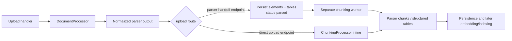
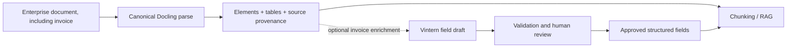

# Document Processing Architecture

This document describes the current implementation in `src/document_processing/` and separates it from the proposed invoice enrichment direction. The package parses source files into normalized `elements`, `tables`, and `metadata`; chunking, persistence, embeddings, and retrieval belong to other modules.

## Current architecture

```mermaid
flowchart TD
    A[PDF / Office / image / text] --> B[DocumentProcessor.process]
    B --> C[Validate extension and intent]
    C --> D{intent?}
    D -->|document; default| E[DoclingProcessor]
    E --> F[PDF: ignore native text cells]
    F --> G[PP-DocLayoutV3 layout regions]
    G --> H[Full-page OCR\nTesseract or VietOCR]
    G --> G1[Preserve all 25 raw Paddle labels\nwith score + bbox]
    G --> J[TableFormer table structure]
    G --> C1[Chart bbox(es) + matched title bbox\nunion crop at 3× → PaddleOCR-VL v1.5]
    E --> K[Office native parsing\nplus embedded image OCR when enabled]
    H --> L[result_mapper]
    J --> L
    C1 --> L
    K --> L
    L --> M[Normalized elements + tables]
    M --> N[DocumentProcessor cleanup\nlabels, text, provenance]

    D -->|invoice; explicit opt-in| O[invoice/processor.py]
    O --> P[Render PDF pages at 2x\nor normalize image orientation]
    P --> Q[Isolated Transformers Python worker]
    Q --> R[Vintern vision-language model\nextracts JSON per page]
    R --> S[Parse fields and preserve raw response]
    S --> T[invoice_extraction + JSON text element\nreview_required = true; tables = empty]
    N --> U[Parser output contract]
    T --> U
```

`document` is the default intent. The local owner-store UI lets a reviewer select `invoice`; the regular upload handler currently constructs `DocumentProcessor` without an invoice intent, so it follows the document path. The invoice branch is therefore an opt-in parser path, not an automatic invoice classifier.

### Document path

1. `DocumentProcessor` validates the extension, selects the intent, and adds common provenance.
2. `DoclingProcessor` always runs full-page OCR on PDFs and discards native PDF text cells. The OCR engine is configurable (`tesseract` or `vietocr`). The local owner-store UI describes the OCR toggle as applying to standalone images and embedded Office pictures; PDFs always use OCR.
3. `PP-DocLayoutV3` supplies layout regions to Docling and raw `layout_detections` (all 25 source labels, confidence, and page bbox) to parser output. A same-page bbox heuristic links figure/table title boxes with the closest compatible chart, figure, or table; it records bidirectional associations and target title metadata while preserving both boxes and source labels. For chart recognition, a uniquely linked title bbox is unioned with its chart bbox, then the crop is rendered at 3× before PaddleOCR-VL v1.5. When one title spans adjacent charts, their chart boxes and shared title form one crop and one chart result. Original chart member boxes and the recognition crop bbox remain in metadata. TableFormer reconstructs table structure and matches OCR text to cells. VietOCR uses RapidOCR for line boxes and VietOCR for text recognition. OCR lines inside detected chart boxes are removed. Generic pictures remain `figure` elements and captions remain separate. Docling receives its supported internal picture label for chart regions. PDF embedded images do not run through a second OCR pass.
4. `result_mapper` maps Docling items into the common element/table shape and applies scanned-output cleanup, including the existing empty-cell dash recovery. `DocumentProcessor` then normalizes labels, text, and provenance.

The detector identifies table regions; TableFormer works on those regions. It is not a second full-page table detector, so a missed table region or omitted part of a region can limit the structure reconstructed downstream.

### Invoice path

1. `invoice/processor.py` accepts PDF and image files, prepares page images, and calls `invoice/vintern_worker.py` through a separate Python executable.
2. The worker loads the configured Vintern model and extracts each page independently using the invoice JSON prompt.
3. The parser preserves the raw response, parses JSON when possible, returns `invoice_extraction.pages`, and creates a JSON text element for downstream search. It currently returns no structured tables and marks every extraction for human review.

The worker defaults to `5CD-AI/Vintern-1B-v2`. The Kaggle fine-tuned checkpoint is not automatically selected by this default; configure `DOCUMENT_PROCESSING_VINTERN_MODEL` to a model directory/repository that the isolated runtime can access before evaluating it through this branch. The current invoice branch replaces the Docling path for that request; it does not combine Vintern fields with Docling OCR or TableFormer output.

## Application handoff



This package ends at parser output. Chunking and persistence are application responsibilities. The parser-handoff path persists raw parser output first and lets the chunking worker consume it; the direct upload path calls `ChunkingProcessor` in the request flow.

## Recommended enterprise invoice direction

For enterprise RAG, keep the general document path as the canonical source of searchable text and tables. Treat invoice extraction as optional structured enrichment over the same source, with page/region provenance and human review. Do not silently replace OCR/table evidence with Vintern JSON. This is a direction for the next design iteration; the current code has two exclusive intents.



A model should enter that optional enrichment path only after evaluation on representative enterprise invoices, with field-level accuracy and explicit handling for missing or uncertain values.

## Code map

| Path | Responsibility |
| --- | --- |
| `document_processor.py` | Validate input and intent; dispatch to a parser; normalize the common result. |
| `docling_adapter/processor.py` | Configure Docling layout, OCR, TableFormer, and embedded-image routes. |
| `docling_adapter/layout_model.py` | Adapt PP-DocLayoutV3 detections into Docling layout clusters. |
| `docling_adapter/scanned/` | RapidOCR line detection, VietOCR recognition, and scanned-result cleanup. |
| `docling_adapter/result_mapper.py` | Map Docling output into normalized elements and tables. |
| `invoice/processor.py` | Prepare invoice pages, call the isolated worker, and shape invoice output. |
| `invoice/vintern_worker.py` | Load Vintern and infer invoice JSON per page. |
