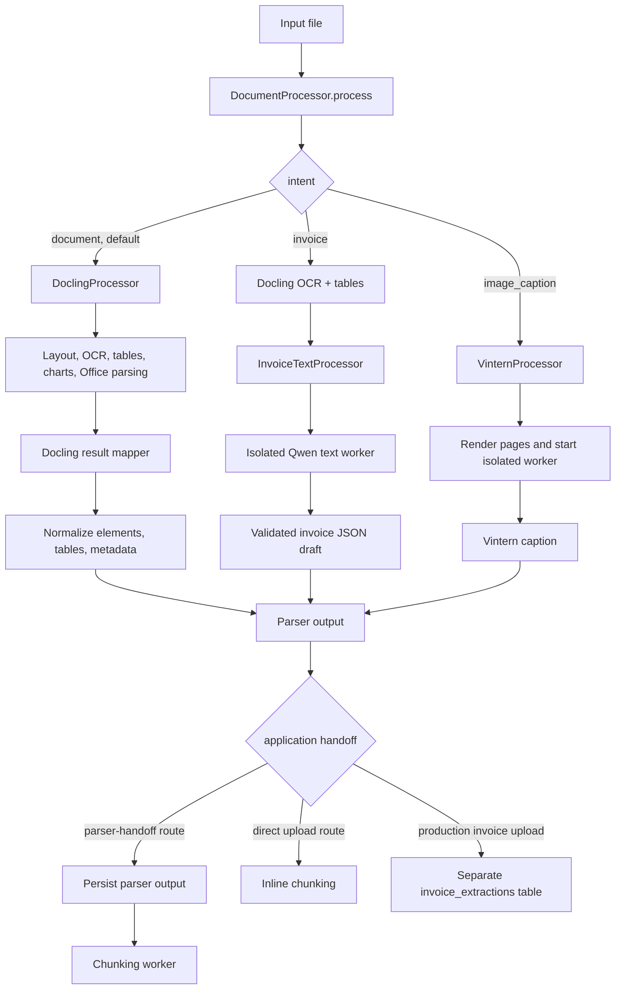

# Document processing architecture

This page is the map for tracing one upload through the current repository.
The parser package ends at normalized parser output; application services own
persistence and the handoff to chunking.

## Current parser routes

Invoice parsing uses Docling for OCR/layout/table extraction and passes only
those text results to the isolated Qwen worker. Production invoice uploads are
stored in `public.invoice_extractions`; they do not create a `documents` row,
parser chunks, or embeddings. Every draft is marked for review. Image caption
continues through Vintern separately.

## Where to trace next

| Stage | Code / guide |
| --- | --- |
| Intent validation and dispatch | [`document_processor.py`](../document_processor.py) |
| Layout, OCR, TableFormer and chart stages | [`docling_adapter/processor.py`](../docling_adapter/processor.py) · [Docling guide](docling-pipeline.md) |
| Element/table mapping and cleanup | [`docling_adapter/result_mapper.py`](../docling_adapter/result_mapper.py) |
| Invoice OCR and text JSON extraction | [`invoice_text_processor.py`](../invoice_text_processor.py) · [Invoice guide](invoice-pipeline.md) |
| Image-caption preparation and inference | [`vintern_processor.py`](../vintern_processor.py) · [`vintern_worker.py`](../vintern_worker.py) |
| Upload Test API and async job status | [`src/app/upload_test.py`](../../app/upload_test.py) |
| Production upload and parser handoff | [`src/app/main.py`](../../app/main.py) |
| Parser output to parser chunks | [`src/core/chunking/README.md`](../../core/chunking/README.md) |

## Boundaries

- `document_processing` returns parser data; it does not persist production
  documents or create embeddings.
- Upload Test can inspect parser output without making a production document.
- The chunking service consumes saved parser output for the parser-handoff
  route. The direct upload route retains its inline chunking flow.
- Output shape and provenance differ by parser route. See
  [metadata](metadata.md) before assuming an optional key is always present.
